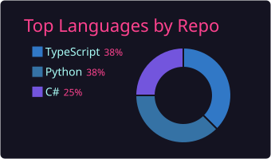
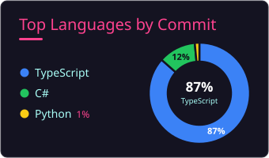
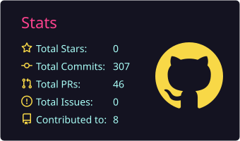
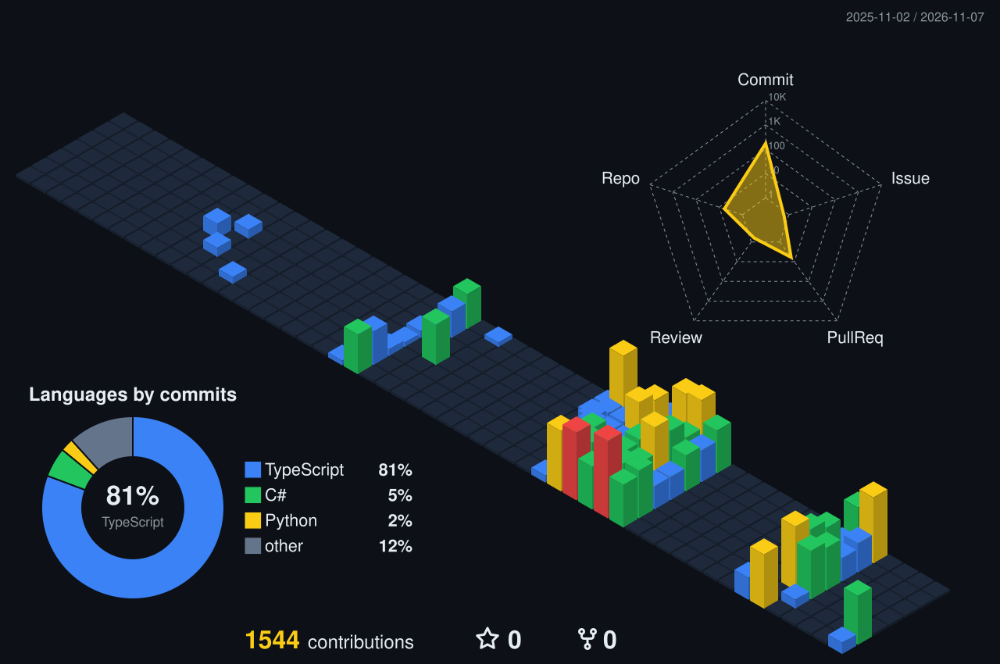

  
  <h1>Hi there! I'm Marco Centeno 👋</h1>
  
<strong>Full Stack Developer | .NET · TypeScript · Local AI</strong>

  
  
    
  

---

### 👤 About Me

I am a passionate Full Stack Developer focused on building robust, scalable web applications and clean code architectures. I specialize in the JavaScript/TypeScript ecosystem, managing everything from dynamic, responsive frontends to microservices, database design, and containerized backend environments.

*   🌱 Currently deep diving into **Monorepo architectures**, database optimization, and scalable APIs.
*   💻 **Development Environment:** Powered by **Linux (WSL2)** & **VS Code**.
*   🐳 Enthusiastic about local AI workflows, self-hosting tools, and **Docker** environments.

---

### 🚀 Tech Stack & Tools

| Category | Technologies & Ecosystem |
| :--- | :--- |
| **Frontend** |     |
| **Backend & APIs** |      |
| **Languages** |     |
| **Databases** |      |
| **Cloud & DevOps** |  -0078D4?style=flat-square&logo=microsoftazure&logoColor=white)  -FCC624?style=flat-square&logo=linux&logoColor=black) |
| **Local AI** |  -412991?style=flat-square)  |

---

### 📊 GitHub Activity

<table width="100%">
  <tr>
    <td width="33%" align="center"></td>
    <td width="33%" align="center"></td>
    <td width="33%" align="center"></td>
  </tr>
  <tr>
    <td colspan="3" align="center">
      
       Contributions over the last year: taller and warmer bars mean more activity that day.
    </td>
  </tr>
</table>

---

### 🛠️ Featured Projects

I like to learn by building complete things, in different stacks. Here is a sample:

| Project | What it is | Stack | Status |
| :--- | :--- | :--- | :--- |
| 🧩 **[TaskFlow](https://github.com/Mack8/taskflow-mvp)** | A minimal Jira-style platform with CQRS, event-driven microservices, REST + GraphQL, SQL + NoSQL and Azure infrastructure as code. | .NET 8 · React · GraphQL · Cosmos DB (Mongo API) · Service Bus · Bicep |  |
| 💰 **[Finanzas App](https://github.com/Mack8/finanzas-app)** | Personal finance tracker with per-user row-level security, recurring payments and a local worker that parses bank purchase alerts. 400+ automated tests. | Next.js 16 · React 19 · TypeScript · Supabase · Vitest |   |
| 🎫 **[SupportFlow](https://github.com/Mack8/supportflow)** | Role-based support ticketing system built as a monorepo. | NestJS · Next.js · Prisma · PostgreSQL · Docker | — |
| 🎙️ **[Transcriptor](https://github.com/Mack8/transcriptor-audio)** | 100% local speech-to-text with GPU acceleration, web UI, CLI and optional summaries from a local LLM. | Python · faster-whisper · CUDA · Gradio · Ollama |   |
| 📚 **[Document RAG Lab](https://github.com/Mack8/documentos-rag-lab)** | Local retrieval-augmented generation lab that answers with source citations, with OCR for scanned PDFs. | Python · Ollama · embeddings · Tesseract |   |
| 📄 **[md2pdf](https://github.com/Mack8/md2pdf)** | Single-file Markdown to PDF converter that uses a headless browser. No cloud, no AI. | Python · CLI |   |
| 🐾 **[GestaPet](https://github.com/Mack8/GestaPet)** | Appointment and operations management for veterinary clinics (academic team project). | Angular · Node.js · Express · Prisma · MySQL |  |
| 🪙 **[NFTrove](https://github.com/Mack8/NFTrove)** | NFT management and sales system (university project). | C# · SQL Server |  |
